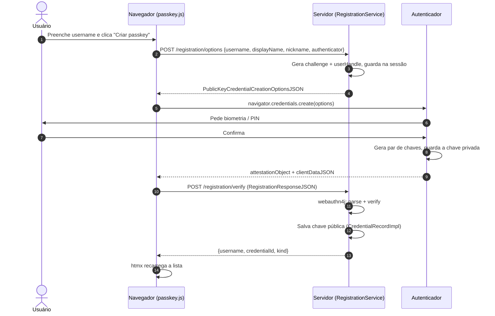
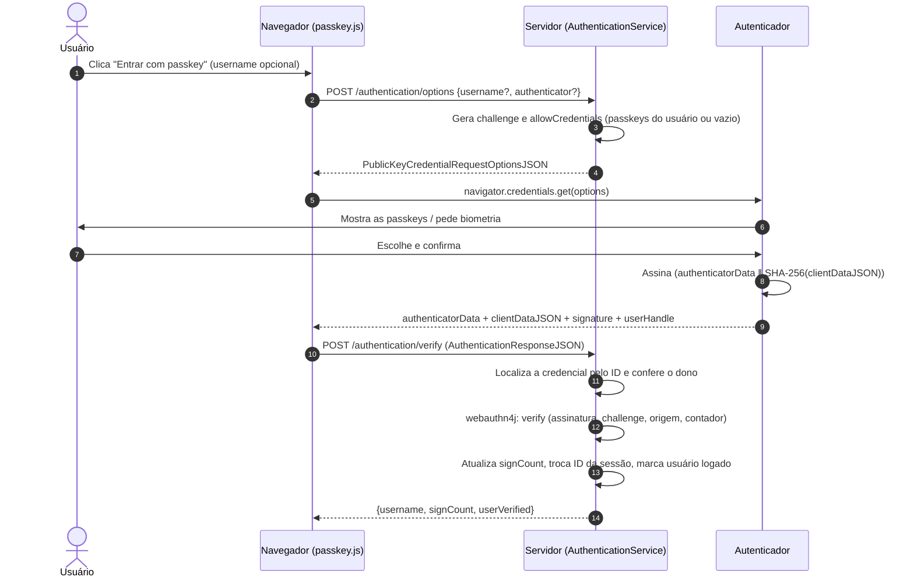

# Passkeys com Spring Web e webauthn4j

Este documento explica **o que são passkeys**, **como funcionam** e **como esta aplicação de demonstração as implementa** com Spring Web e a biblioteca [webauthn4j](https://webauthn4j.github.io/webauthn4j/en/), sem Spring Security. No fim, há uma referência de **todas as opções de configuração**: as do protocolo WebAuthn, as da biblioteca e as do projeto.

> **Sumário**
> 1. [O que é uma passkey](#1-o-que-é-uma-passkey)
> 2. [Conceitos fundamentais](#2-conceitos-fundamentais)
> 3. [Arquitetura desta aplicação](#3-arquitetura-desta-aplicação)
> 4. [Fluxo de registro](#4-fluxo-de-registro)
> 5. [Fluxo de autenticação (validação)](#5-fluxo-de-autenticação-validação)
> 6. [Listagem e remoção](#6-listagem-e-remoção)
> 7. [Vantagens](#7-vantagens)
> 8. [Desvantagens e desafios](#8-desvantagens-e-desafios)
> 9. [Referência de configuração](#9-referência-de-configuração)
> 10. [Logs: como ler e depurar](#10-logs-como-ler-e-depurar)
> 11. [Boas práticas de segurança](#11-boas-práticas-de-segurança)
> 12. [Limitações desta demonstração](#12-limitações-desta-demonstração)
> 13. [Como executar e testar](#13-como-executar-e-testar)
> 14. [Referências](#14-referências)

---

## 1. O que é uma passkey

Uma **passkey** é uma credencial de login que **substitui a senha** por um **par de chaves criptográficas**:

- a **chave privada** fica guardada no dispositivo do usuário (celular, notebook, chave de segurança USB) e **nunca sai de lá**;
- a **chave pública** é enviada ao site e guardada no servidor.

Para entrar, o site envia um desafio aleatório (*challenge*). O dispositivo **assina** esse desafio com a chave privada, depois de o usuário confirmar com biometria, PIN ou padrão de desbloqueio. O servidor **confere a assinatura** com a chave pública. Se a assinatura for válida, o usuário provou que possui a chave privada sem nunca revelá-la.

O termo "passkey" é o nome comercial adotado por Apple, Google, Microsoft e pela FIDO Alliance. Tecnicamente, uma passkey é uma **credencial FIDO2/WebAuthn descobrível**.

### Siglas que você vai encontrar

| Sigla | Significado | Papel |
|---|---|---|
| **FIDO2** | Projeto da FIDO Alliance | Nome guarda-chuva para WebAuthn + CTAP2. |
| **WebAuthn** | *Web Authentication*, especificação do W3C | API JavaScript (`navigator.credentials`) que o site usa para conversar com o navegador. |
| **CTAP2** | *Client to Authenticator Protocol* | Protocolo que o navegador usa para conversar com o autenticador (USB, NFC, Bluetooth ou interno). |
| **U2F** | *Universal 2nd Factor* | Antecessor do FIDO2, usado como segundo fator. Ainda é suportado. |

---

## 2. Conceitos fundamentais

### 2.1 Os três participantes

```
┌──────────────────┐      WebAuthn (JS)      ┌──────────────┐      CTAP2       ┌──────────────────┐
│  Relying Party   │ ◄─────────────────────► │   Cliente    │ ◄──────────────► │   Autenticador   │
│ (seu servidor)   │   HTTP + JSON           │ (navegador)  │  USB/NFC/BLE/... │ (Touch ID, YubiKey│
│  Spring + w4j    │                         │              │                  │  celular, ...)   │
└──────────────────┘                         └──────────────┘                  └──────────────────┘
```

- **Relying Party (RP)**: o serviço que "confia" na autenticação, ou seja, o seu servidor. Nesta demo, é a aplicação Spring.
- **Cliente**: o navegador (ou o sistema operacional, em apps nativos). Ele faz a ponte entre o site e o autenticador e **acrescenta a origem da página** aos dados assinados. É isso que torna as passkeys resistentes a phishing.
- **Autenticador**: o componente que gera e guarda as chaves e pede a confirmação do usuário.
  - **De plataforma** (`platform`): embutido no dispositivo. Exemplos: Touch ID/Face ID, Windows Hello, sensor do Android.
  - **Itinerante** (`cross-platform`, *roaming*): externo. Exemplos: YubiKey, ou um celular usado via QR code (transporte `hybrid`).

### 2.2 Vocabulário essencial

| Termo | O que é |
|---|---|
| **RP ID** | Domínio ao qual a passkey fica presa (ex.: `exemplo.com.br`). Uma passkey criada para `exemplo.com.br` **nunca** será oferecida em `exemp1o.com.br`. |
| **Origem** (*origin*) | Esquema + host + porta da página (ex.: `https://login.exemplo.com.br`). O navegador a coloca no `clientDataJSON` e o servidor confere. |
| **Challenge** | Bytes aleatórios gerados pelo servidor para cada operação. Impedem que uma resposta antiga seja reutilizada (*replay*). |
| **Credential ID** | Identificador da passkey, gerado pelo autenticador. |
| **User handle** (`user.id`) | Identificador do usuário **definido pelo servidor**, guardado junto com a passkey. Deve ser aleatório e **sem dados pessoais**. |
| **Cerimônia** | Nome que a especificação dá a cada operação: *registration ceremony* e *authentication ceremony*. |
| **Atestação** (*attestation*) | Declaração, assinada pelo fabricante, de **qual modelo de autenticador** criou a chave. É opcional. |
| **Asserção** (*assertion*) | A resposta assinada que o autenticador devolve no login. |
| **AAGUID** | Identificador do **modelo** do autenticador (128 bits). Fica zerado quando não há atestação. |
| **signCount** | Contador incrementado a cada uso. Ajuda a detectar autenticadores clonados. Passkeys sincronizadas costumam mantê-lo em `0`. |
| **COSE** | Formato (RFC 9052/9053) em que a chave pública e o algoritmo são codificados. |
| **CBOR** | Formato binário (parecido com JSON) usado no `attestationObject` e no `authenticatorData`. |

### 2.3 Credencial descobrível (*discoverable credential* / *resident key*)

- **Descobrível**: o autenticador guarda a passkey **junto com o user handle e o nome do usuário**. O navegador consegue listar as passkeys disponíveis para o site **sem que o usuário digite nada**. Isso permite o login **sem username**. **Toda passkey é descobrível.**
- **Não descobrível**: o autenticador não guarda nada localmente (a chave privada fica "embrulhada" dentro do próprio credential ID). O servidor precisa saber de antemão quais credenciais aceitar (`allowCredentials`), então o usuário precisa informar quem é. É o modelo clássico de "chave de segurança como segundo fator".

### 2.4 Passkeys sincronizadas × vinculadas ao dispositivo

| Tipo | Flag BE | Exemplo | Característica |
|---|---|---|---|
| **Sincronizada** (*multi-device*) | `BE = 1` | iCloud Keychain, Google Password Manager, 1Password, Bitwarden | Copiada (de forma criptografada) entre os dispositivos da mesma conta. Se você perder o celular, não perde a passkey. |
| **Vinculada ao dispositivo** (*device-bound*) | `BE = 0` | YubiKey, alguns cenários do Windows Hello | Nunca sai do hardware. Mais controle, porém sem backup. |

### 2.5 Flags do `authenticatorData`

Toda resposta do autenticador traz um byte de flags. Os logs da aplicação mostram cada uma:

| Flag | Nome | Significado |
|---|---|---|
| `UP` | *User Present* | Houve interação física (toque, clique). |
| `UV` | *User Verified* | O usuário foi **verificado** (biometria, PIN, senha do dispositivo). |
| `BE` | *Backup Eligible* | A credencial **pode** ser sincronizada. Não muda depois do registro. |
| `BS` | *Backup State* | A credencial **está** sincronizada neste momento. Pode mudar. |
| `AT` | *Attested credential data* | Há dados de credencial (chave pública). Aparece no registro. |
| `ED` | *Extension Data* | Há saídas de extensões. |

---

## 3. Arquitetura desta aplicação

### 3.1 Por que sem Spring Security?

O Spring Security tem suporte a passkeys, mas ele **esconde** os passos do protocolo. Esta demo usa o **webauthn4j-core diretamente**, o mesmo motor que o Spring Security usa internamente. Assim, cada etapa (gerar challenge, montar opções, validar resposta, atualizar contador) fica **explícita no código e nos logs**. O controle de sessão é feito com `HttpSession` puro.

### 3.2 Pilha tecnológica

| Camada | Tecnologia |
|---|---|
| Backend | Java 25, Spring Boot 4.1 (Spring Web MVC), Bean Validation |
| WebAuthn | `com.webauthn4j:webauthn4j-core` 0.31.11 (usa Jackson 3, o mesmo do Spring Boot 4) |
| Persistência | Em memória (`ConcurrentHashMap`) |
| Interface | Thymeleaf (HTML no servidor), htmx (atualização parcial da página), Tailwind CSS (estilo) |
| Navegador | `static/js/passkey.js`, que chama a API WebAuthn |
| Testes | JUnit 5, MockMvc e `webauthn4j-test` (autenticador emulado) |

### 3.3 Mapa de classes

```
io.github.tonyblack10.passkeydemo
├── config
│   ├── WebAuthnProperties        → lê passkey.* do application.properties
│   └── WebAuthnConfig            → beans: WebAuthnManager, ObjectConverter, algoritmos, Clock
├── model
│   ├── UserAccount               → usuário (userHandle aleatório, username, displayName)
│   └── StoredCredential          → passkey (envolve o CredentialRecordImpl do webauthn4j)
├── repository
│   ├── InMemoryUserRepository
│   └── InMemoryCredentialRepository
├── service
│   ├── ChallengeStore            → guarda o challenge na sessão (uso único + expiração)
│   ├── RegistrationService       → cerimônia de registro (start / finish)
│   ├── AuthenticationService     → cerimônia de autenticação (start / finish)
│   └── WebAuthnSupport           → ServerProperty, descritores, logs de clientData/flags
├── dto                           → JSON trocado com o navegador
└── web
    ├── PasskeyApiController      → /api/passkeys/** (JSON)
    ├── PageController            → página e fragmentos htmx
    ├── ApiExceptionHandler       → erros → Problem Details (RFC 9457)
    └── RequestLoggingFilter      → requestId no MDC + log de cada requisição
```

### 3.4 Endpoints

| Método | Caminho | Função |
|---|---|---|
| `GET` | `/` | Página principal |
| `POST` | `/api/passkeys/registration/options` | Registro, passo 1: gera challenge e opções |
| `POST` | `/api/passkeys/registration/verify` | Registro, passo 2: valida e salva a passkey |
| `POST` | `/api/passkeys/authentication/options` | Login, passo 1: gera challenge e opções |
| `POST` | `/api/passkeys/authentication/verify` | Login, passo 2: valida a assinatura |
| `GET` | `/fragments/credentials` | Fragmento htmx com a lista de passkeys |
| `GET` | `/fragments/session` | Fragmento htmx com o status da sessão |
| `DELETE` | `/credentials/{id}` | Remove uma passkey (htmx) |
| `POST` | `/logout` | Encerra a sessão (htmx) |

---

## 4. Fluxo de registro



### Passo a passo no código

1. **`RegistrationService.start`**
   - Normaliza o username (minúsculas, sem espaços nas pontas).
   - Reaproveita o `userHandle` se o usuário já existe, ou gera **32 bytes aleatórios** com `SecureRandom`.
   - Monta `excludeCredentials` com as passkeys que o usuário já tem, para não registrar o mesmo autenticador duas vezes.
   - Gera o challenge com `new DefaultChallenge()` (16 bytes aleatórios) e o guarda na sessão via `ChallengeStore`.
   - Devolve as opções em JSON (campos binários em Base64URL).
2. **No navegador (`passkey.js`)**: converte o JSON em `ArrayBuffer`s (com `PublicKeyCredential.parseCreationOptionsFromJSON` quando o navegador oferece), chama `navigator.credentials.create()` e serializa a resposta com `credential.toJSON()`.
3. **`RegistrationService.finish`**
   - **Consome** o challenge da sessão (uso único; expira após `passkey.timeout`).
   - `webAuthnManager.parseRegistrationResponseJSON(json)` decodifica o JSON, o `clientDataJSON` e o `attestationObject` (CBOR).
   - `webAuthnManager.verify(data, RegistrationParameters)` confere:
     - `clientDataJSON.type == "webauthn.create"`;
     - o **challenge** é o que o servidor gerou;
     - a **origem** está em `passkey.origins`;
     - o **hash do RP ID** no `authenticatorData` é o SHA-256 de `passkey.rp-id`;
     - a flag **UP** está ligada e, se configurado, a **UV** também;
     - o **algoritmo** da chave está em `passkey.algorithms`;
     - a **declaração de atestação** é válida para o seu formato.
   - Cria o `CredentialRecordImpl`, que guarda a chave pública COSE, o contador, os transportes e as flags BE/BS/UV, e salva.

---

## 5. Fluxo de autenticação (validação)



### Dois modos de login

| Modo | `allowCredentials` | Como o servidor descobre o usuário |
|---|---|---|
| **Com username** | Lista as passkeys do usuário | Pelo username informado. O servidor confere se a credencial usada está na lista. |
| **Sem username** (*usernameless*) | Vazio | Pelo **`userHandle`** que o autenticador devolve. Só funciona com credenciais descobríveis. |

### Passo a passo no código

1. **`AuthenticationService.start`**: gera o challenge, monta `allowCredentials` (se houver username) e guarda tudo na sessão.
2. **`AuthenticationService.finish`**
   - Consome o challenge.
   - `parseAuthenticationResponseJSON` decodifica a resposta.
   - Busca a credencial pelo **credential ID**. Se ela foi removida do servidor, o login falha.
   - `verifyOwnership` confere se o `userHandle` da resposta pertence ao dono da credencial (e ao usuário informado, se houver).
   - `webAuthnManager.verify(data, AuthenticationParameters)` confere `type == "webauthn.get"`, challenge, origem, hash do RP ID, flags UP/UV, a **assinatura** com a chave pública guardada e o **contador** (deve ser maior que o anterior, a menos que ambos sejam `0`).
   - Atualiza `signCount`, `BS`, `uvInitialized` e a data de último uso, de forma atômica (`synchronized`).
3. **`PasskeyApiController`** chama `request.changeSessionId()` antes de gravar o usuário na sessão, o que **previne fixação de sessão**.

---

## 6. Listagem e remoção

A seção "Passkeys registradas" é um **fragmento Thymeleaf** carregado pelo htmx:

- `hx-trigger="load"`: carrega ao abrir a página;
- `hx-trigger="credentialsChanged from:body"`: recarrega sempre que o `passkey.js` dispara esse evento depois de um registro ou login;
- o botão **Remover** usa `hx-delete` + `hx-confirm` e substitui a lista pelo fragmento devolvido.

Para cada passkey são exibidos: usuário, apelido, credential ID, tipo (sincronizável ou vinculada), algoritmo, formato de atestação, AAGUID, transportes, flags BE/BS/UV, signCount e datas.

> ⚠️ **Remover no servidor não apaga a passkey do dispositivo.** Ela continua aparecendo no gerenciador de senhas do usuário, mas passa a ser rejeitada ("Passkey não reconhecida"). A [Signals API](https://w3c.github.io/webauthn/#sctn-signal-methods) (`PublicKeyCredential.signalUnknownCredential`) permite avisar o navegador para escondê-la. Ela é recente e ainda não é suportada por todos os navegadores.

---

## 7. Vantagens

| Vantagem | Explicação |
|---|---|
| **Resistência a phishing** | O navegador inclui a origem real nos dados assinados, e a passkey só é oferecida para o RP ID correto. Um site falso não consegue obter uma assinatura válida para o site verdadeiro. |
| **Nenhum segredo no servidor** | O servidor guarda só chaves **públicas**. Um vazamento do banco de dados não permite entrar como ninguém. |
| **Sem reutilização de senha** | Cada site tem um par de chaves único. Não há *credential stuffing*. |
| **Fim de senhas fracas** | Não há o que adivinhar nem ataque de força bruta remoto. |
| **Experiência melhor** | Um toque ou um olhar no lugar de digitar senha + código SMS. Pesquisas do Google e da FIDO Alliance mostram logins mais rápidos e com mais sucesso. |
| **MFA embutido** | Posse do dispositivo + biometria/PIN (UV) = dois fatores em um só gesto. |
| **Biometria local** | A digital ou o rosto **nunca saem do dispositivo**; o servidor só recebe a flag `UV`. |
| **Padrão aberto** | W3C + FIDO Alliance, suportado pelos principais sistemas e navegadores. |
| **Sincronização** | Passkeys sincronizadas reduzem o risco de perda do dispositivo. |

## 8. Desvantagens e desafios

| Desvantagem | Explicação |
|---|---|
| **Recuperação de conta** | Se o usuário perder todos os dispositivos e não tiver sincronização, é preciso outro caminho (e-mail, documento, outra passkey). Esse caminho vira o elo mais fraco. |
| **Dependência de ecossistemas** | Passkeys sincronizadas ficam presas ao provedor (Apple, Google, Microsoft, gerenciador de senhas). A migração entre provedores (padrões CXP/CXF) ainda está amadurecendo. |
| **RP ID amarrado ao domínio** | Trocar de domínio "perde" as passkeys. Usar vários domínios exige *Related Origin Requests* (`/.well-known/webauthn`). |
| **Complexidade de implementação** | CBOR, COSE, atestação, flags e contadores: o protocolo é bem mais complexo que comparar um hash de senha. Use uma biblioteca madura. |
| **Compatibilidade** | Navegadores, sistemas e dispositivos antigos não suportam passkeys ou só suportam parte das funções. |
| **Experiência ainda heterogênea** | Os diálogos variam entre sistemas. Alguns usuários não entendem o que é uma "passkey" ou onde ela fica guardada. |
| **Atestação limitada** | Passkeys de consumidor normalmente usam atestação `none`. O servidor não sabe com certeza qual hardware gerou a chave. |
| **Dispositivos compartilhados** | Em um computador compartilhado, criar a passkey no autenticador local pode não ser desejável. É preciso usar o celular (hybrid) ou uma chave de segurança. |
| **Contador pouco útil** | Passkeys sincronizadas mantêm `signCount = 0`, então a detecção de clones pelo contador não funciona para elas. |
| **Remoção não sincronizada** | Apagar no servidor não apaga no dispositivo (veja a seção 6). |

---

## 9. Referência de configuração

Esta seção cobre **três níveis** de configuração:

1. [Propriedades do projeto](#91-propriedades-do-projeto-passkey) (`application.properties`);
2. [Opções do protocolo WebAuthn](#92-opções-de-registro-publickeycredentialcreationoptions), enviadas ao navegador;
3. [Parâmetros da biblioteca webauthn4j](#95-parâmetros-do-webauthn4j), usados na validação.

### 9.1 Propriedades do projeto (`passkey.*`)

Definidas em `src/main/resources/application.properties` e lidas pelo record `WebAuthnProperties`. São validadas na inicialização (`@Validated`): um valor inválido impede a aplicação de subir.

| Propriedade | Padrão no projeto | Valores | Para que serve |
|---|---|---|---|
| `passkey.rp-id` | `localhost` | Um domínio | **RP ID.** Precisa ser o domínio da página ou um "sufixo registrável" dele. Em `https://login.exemplo.com.br`, pode ser `login.exemplo.com.br` ou `exemplo.com.br`, mas não `com.br`. **Não** inclui esquema nem porta. Escolha com cuidado: mudar depois invalida todas as passkeys. |
| `passkey.rp-name` | `Passkey Demo` | Texto | Nome amigável enviado em `rp.name`. Alguns autenticadores o exibem. |
| `passkey.origins` | `http://localhost:8080` | Lista separada por vírgula | Origens aceitas no `clientDataJSON`. Inclui esquema e porta. Em produção, **sempre HTTPS**. Para apps Android, a origem tem o formato `android:apk-key-hash:<hash>`. |
| `passkey.timeout` | `120s` | `Duration` (`60s`, `2m`...) | Usada em dois lugares: no `timeout` enviado ao navegador (quanto tempo ele espera o usuário) e na **validade do challenge** no servidor. |
| `passkey.user-verification` | `preferred` | `required`, `preferred`, `discouraged` | Vai para `authenticatorSelection.userVerification` e `userVerification`. Com `required`, o servidor também **rejeita** respostas sem a flag UV. |
| `passkey.resident-key` | `required` | `required`, `preferred`, `discouraged` | Vai para `authenticatorSelection.residentKey`. `required` garante credenciais descobríveis, necessárias para o login sem username. |
| `passkey.attestation` | `none` | `none`, `indirect`, `direct`, `enterprise` | Vai para `attestation`. Veja a [seção 9.2](#92-opções-de-registro-publickeycredentialcreationoptions). |
| `passkey.authenticator-attachment` | *(vazio)* | vazio, `platform`, `cross-platform` | Restringe o tipo de autenticador. Vazio = qualquer um. |
| `passkey.algorithms` | `-7,-8,-257` | Identificadores COSE | Algoritmos aceitos, em ordem de preferência. Usados nas opções (`pubKeyCredParams`) **e** na validação do registro. |

Outras propriedades relevantes do Spring:

| Propriedade | Valor | Motivo |
|---|---|---|
| `server.servlet.session.timeout` | `30m` | Duração da sessão (onde ficam o challenge e o usuário logado). |
| `server.servlet.session.cookie.http-only` | `true` | O JavaScript não consegue ler o cookie de sessão (mitiga XSS). |
| `server.servlet.session.cookie.same-site` | `lax` | O cookie não é enviado em POSTs vindos de outros sites (mitiga CSRF). |
| `server.servlet.session.tracking-modes` | `cookie` | Evita o ID de sessão na URL (`;jsessionid=`). |
| `logging.level.io.github.tonyblack10.passkeydemo` | `DEBUG` | Mostra todos os passos dos fluxos. |
| `logging.level.com.webauthn4j` | `DEBUG` | Mostra os logs internos da biblioteca. |
| `logging.pattern.console` | inclui `%X{requestId}` | Correlaciona as linhas de log de uma mesma requisição. |
| `spring.mvc.log-resolved-exception` | `false` | Evita log duplicado: o `ApiExceptionHandler` já registra os erros. |
| `spring.thymeleaf.cache` | `false` | Recarrega os templates sem reiniciar (só em desenvolvimento). |
| `management.endpoints.web.exposure.include` | `health,info` | Expõe só endpoints seguros do Actuator. |

### 9.2 Opções de registro (`PublicKeyCredentialCreationOptions`)

Objeto passado para `navigator.credentials.create({ publicKey })`. O servidor o gera em `RegistrationService.start` (record `WebAuthnJson.CreationOptions`).

#### `rp`: a Relying Party

| Campo | Obrigatório | Descrição |
|---|---|---|
| `rp.id` | Não | RP ID. Se omitido, o navegador usa o domínio da página atual. **Recomenda-se sempre enviar.** |
| `rp.name` | Sim | Nome amigável do serviço. |

#### `user`: o usuário

| Campo | Obrigatório | Descrição |
|---|---|---|
| `user.id` | Sim | *User handle*: de 1 a 64 bytes, **aleatório e sem dados pessoais**. É devolvido no login sem username. Registrar de novo com o **mesmo** `user.id` no mesmo autenticador **substitui** a passkey anterior. |
| `user.name` | Sim | Identificador legível (username, e-mail). Aparece no seletor de passkeys. |
| `user.displayName` | Sim | Nome para exibição ("Maria Silva"). Pode ser vazio. |

#### `challenge`

Bytes aleatórios e imprevisíveis, com **pelo menos 16 bytes**, gerados no servidor, de **uso único** e com validade curta. O autenticador o assina indiretamente (via `clientDataJSON`), o que prova que a resposta é "fresca".

#### `pubKeyCredParams`: algoritmos aceitos

Lista de `{ type: "public-key", alg: <id COSE> }` em **ordem de preferência**. O autenticador usa o primeiro que suportar.

| `alg` | Nome | Descrição |
|---|---|---|
| `-7` | **ES256** | ECDSA com curva P-256 e SHA-256. **O mais suportado; sempre inclua.** |
| `-8` | **EdDSA** | Ed25519. Moderno e rápido; usado por algumas chaves de segurança. |
| `-257` | **RS256** | RSASSA-PKCS1-v1_5 com SHA-256. Necessário para o Windows Hello em alguns cenários. |
| `-35` | ES384 | ECDSA P-384 com SHA-384. |
| `-36` | ES512 | ECDSA P-521 com SHA-512. |
| `-37` | PS256 | RSASSA-PSS com SHA-256. |
| `-258` / `-259` | RS384 / RS512 | RSA PKCS1 com SHA-384 / SHA-512. |
| `-65535` | RS1 | RSA com SHA-1. **Legado e inseguro; evite.** |

Recomendação usual: `[-7, -8, -257]`, o padrão do projeto.

#### `timeout`

Tempo em milissegundos que o navegador espera a interação do usuário. É uma **dica**: o navegador pode ajustar. A especificação recomenda entre 5 e 10 minutos quando há verificação do usuário. Esta demo usa 2 minutos.

#### `excludeCredentials`

Lista de credenciais que o usuário **já possui** (`{ type, id, transports }`). Se o autenticador reconhecer alguma, ele **recusa** criar outra (erro `InvalidStateError` no navegador). Isso evita duplicatas no mesmo dispositivo.

#### `authenticatorSelection`

| Campo | Valores | Descrição |
|---|---|---|
| `authenticatorAttachment` | `platform`, `cross-platform`, ausente | `platform`: só o autenticador embutido. `cross-platform`: só externos (chave USB, celular via QR). Ausente: o usuário escolhe. |
| `residentKey` | `required`, `preferred`, `discouraged` | Se a credencial deve ser **descobrível**. Para passkeys, use `required` (ou `preferred`). |
| `requireResidentKey` | `true`/`false` | Campo do WebAuthn nível 1, mantido por compatibilidade. Deve ser `true` quando `residentKey = required`. |
| `userVerification` | `required`, `preferred`, `discouraged` | `required`: o autenticador **precisa** verificar o usuário (biometria/PIN); se não puder, a operação falha. `preferred`: verifica se possível (padrão). `discouraged`: evita pedir verificação (só presença). |

#### `hints` (WebAuthn nível 3)

Dicas de interface, em ordem de preferência. Não restringem nada, só orientam a UI do navegador.

| Valor | Significado |
|---|---|
| `security-key` | Sugere uma chave de segurança física. |
| `client-device` | Sugere o autenticador do próprio dispositivo. |
| `hybrid` | Sugere usar o celular (QR code + Bluetooth). |

> **Nesta demo**, o campo *Tipo de autenticador* dos formulários controla `authenticatorAttachment` e `hints` em cada operação (enum `AuthenticatorPreference`):
>
> | Opção na tela | `authenticatorAttachment` | `hints` |
> |---|---|---|
> | Qualquer | valor de `passkey.authenticator-attachment` (vazio = qualquer) | — |
> | Este dispositivo | `platform` | `client-device` |
> | Chave de segurança | `cross-platform` | `security-key` |
> | Celular ou tablet | `cross-platform` | `hybrid` |
>
> No login, só os `hints` são enviados: `authenticatorAttachment` não existe nas opções de autenticação.

#### `attestation`: preferência de atestação

| Valor | O que o servidor recebe | Quando usar |
|---|---|---|
| `none` | Nenhuma atestação (o AAGUID pode vir zerado). | **Padrão recomendado** para sites de consumidor. Melhor privacidade e compatibilidade. |
| `indirect` | Uma atestação que o cliente **pode anonimizar**. | Raramente útil. |
| `direct` | A atestação original do autenticador. | Quando é preciso saber o modelo exato (ex.: aceitar só chaves certificadas). O navegador pode pedir consentimento ao usuário. |
| `enterprise` | Atestação que pode identificar o **dispositivo individual**. | Só em ambientes corporativos gerenciados, com RPs previamente autorizadas pela política da empresa. |

#### `attestationFormats` (nível 3)

Lista de formatos de atestação preferidos, em ordem: `packed`, `tpm`, `android-key`, `android-safetynet`, `fido-u2f`, `apple`, `none`. É uma dica para o autenticador.

#### `extensions`: extensões de registro

| Extensão | Entrada | Saída | Para que serve |
|---|---|---|---|
| `credProps` | `true` | `{ rk: boolean }` | Informa se a credencial criada é **descobrível**. **Usada nesta demo** (aparece no log de registro). |
| `credentialProtectionPolicy` + `enforceCredentialProtectionPolicy` | `userVerificationOptional`, `userVerificationOptionalWithCredentialIDList`, `userVerificationRequired` | (do autenticador) | *credProtect*: exige UV até para **descobrir** a credencial (protege a privacidade em chaves de segurança). |
| `largeBlob` | `{ support: "required" \| "preferred" }` | `{ supported }` | Permite guardar um pequeno blob de dados junto com a credencial. |
| `prf` | `{ eval: { first, second? } }` | `{ enabled, results? }` | *Pseudo-Random Function*: deriva segredos a partir da passkey. Útil para **criptografia de ponta a ponta**. Baseada em `hmac-secret`. |
| `hmacCreateSecret` | `true` | `boolean` | Versão CTAP de baixo nível do PRF. |
| `minPinLength` | `true` | (do autenticador) | Pede o tamanho mínimo de PIN configurado na chave. |
| `appidExclude` | URL do AppID | `boolean` | Evita registrar de novo um autenticador que já tem credencial U2F legada. |

### 9.3 Opções de autenticação (`PublicKeyCredentialRequestOptions`)

Objeto passado para `navigator.credentials.get({ publicKey })`. O servidor o gera em `AuthenticationService.start` (record `WebAuthnJson.RequestOptions`).

| Campo | Descrição |
|---|---|
| `challenge` | Igual ao do registro: aleatório, de uso único e com expiração. |
| `timeout` | Tempo de espera em milissegundos (dica). |
| `rpId` | RP ID. Se omitido, o navegador usa o domínio da página. Precisa ser **o mesmo** usado no registro. |
| `allowCredentials` | Lista `{ type, id, transports }` das credenciais aceitas. **Vazia** = o navegador oferece qualquer passkey descobrível do RP (login sem username). Os `transports` ajudam o navegador a escolher o canal (ex.: não mostrar o QR code se só existe `internal`). |
| `userVerification` | `required`, `preferred` ou `discouraged` (mesmo significado do registro). |
| `hints` | `security-key`, `client-device`, `hybrid` (nível 3). |
| `extensions` | Veja abaixo. |

Extensões de autenticação:

| Extensão | Para que serve |
|---|---|
| `appid` | Permite usar credenciais **U2F legadas** registradas com um AppID. |
| `prf` | Deriva segredos (com `eval` ou `evalByCredential`). |
| `largeBlob` | `{ read: true }` ou `{ write: <bytes> }` para ler ou escrever o blob. |
| `hmacGetSecret` | Versão de baixo nível do PRF. |
| `uvm` | *User Verification Method*: informava como o usuário foi verificado. **Removida** da especificação; os navegadores não a implementam mais. |

### 9.4 Opções do `navigator.credentials.create/get` (fora de `publicKey`)

| Opção | Valores | Descrição |
|---|---|---|
| `mediation` | `silent`, `optional` (padrão), `conditional`, `required` | **`conditional` no `get()`** ativa o *autofill* de passkeys: a passkey aparece nas sugestões do campo de username (o input precisa de `autocomplete="username webauthn"`). **`conditional` no `create()`** permite que o gerenciador de senhas crie uma passkey automaticamente depois de um login com senha (*automatic passkey upgrade*). |
| `signal` | `AbortSignal` | Cancela a operação em andamento (ex.: abortar o autofill quando o usuário clica em outro botão). |

> Para usar o autofill, verifique antes `PublicKeyCredential.isConditionalMediationAvailable()`. A página desta demo exibe esse e outros testes de suporte. O campo de username de login já está com `autocomplete="username webauthn"`, pronto para evoluir para esse modo.

#### Transportes (`transports`)

Indicam **como** o navegador alcança o autenticador. O servidor os recebe no registro (`getTransports()`), guarda e devolve em `allowCredentials`/`excludeCredentials`.

| Valor | Significado |
|---|---|
| `internal` | Autenticador de plataforma (embutido). |
| `usb` | Chave USB. |
| `nfc` | Aproximação (NFC). |
| `ble` | Bluetooth Low Energy. |
| `smart-card` | Cartão inteligente (ISO/IEC 7816). |
| `hybrid` | Celular via QR code + Bluetooth (antigo `cable`). |

### 9.5 Parâmetros do webauthn4j

#### `WebAuthnManager`

Ponto de entrada da biblioteca. É **thread-safe**, então crie uma única instância (bean). Métodos usados na demo:

| Método | O que faz |
|---|---|
| `parseRegistrationResponseJSON(String)` | Converte o JSON do `toJSON()` em `RegistrationData` (sem validar). Lança `DataConversionException` se o JSON for malformado. |
| `verify(RegistrationData, RegistrationParameters)` | Valida o registro. Lança subclasses de `VerificationException`. |
| `parseAuthenticationResponseJSON(String)` | Converte o JSON da asserção em `AuthenticationData`. |
| `verify(AuthenticationData, AuthenticationParameters)` | Valida a autenticação. |
| `verifyRegistrationResponseJSON` / `verifyAuthenticationResponseJSON` | Fazem parse e validação em uma só chamada. A demo separa as duas etapas para registrar o conteúdo nos logs entre elas. |

Formas de construção:

| Forma | Quando usar |
|---|---|
| `WebAuthnManager.createNonStrictWebAuthnManager()` | **Usada nesta demo.** Aceita **todos** os formatos de atestação, mas **não** confere a cadeia de certificados nem a auto-atestação (usa os verificadores "Null"). Ideal com `attestation = none`. |
| `new WebAuthnManager(attestationStatementVerifiers, certPathTrustworthinessVerifier, selfAttestationTrustworthinessVerifier, customRegistrationVerifiers, customAuthenticationVerifiers, objectConverter)` | Validação **estrita** da atestação, para aceitar apenas autenticadores conhecidos. |

Parâmetros do construtor completo:

| Parâmetro | Descrição e implementações |
|---|---|
| `attestationStatementVerifiers` | Um verificador por formato aceito: `NoneAttestationStatementVerifier`, `PackedAttestationStatementVerifier`, `FIDOU2FAttestationStatementVerifier`, `AndroidKeyAttestationStatementVerifier`, `AndroidSafetyNetAttestationStatementVerifier`, `TPMAttestationStatementVerifier`, `AppleAnonymousAttestationStatementVerifier`. Formatos fora da lista são rejeitados. As versões `Null*` aceitam o formato sem validar. |
| `certPathTrustworthinessVerifier` | Valida a **cadeia de certificados** da atestação. `DefaultCertPathTrustworthinessVerifier(TrustAnchorRepository)` exige uma âncora confiável; `NullCertPathTrustworthinessVerifier` aceita tudo. |
| `selfAttestationTrustworthinessVerifier` | Decide se a **auto-atestação** (chave assinando a si mesma) é aceita. `DefaultSelfAttestationTrustworthinessVerifier` tem a opção `setSelfAttestationAllowed(boolean)`; `NullSelfAttestationTrustworthinessVerifier` aceita. |
| `customRegistrationVerifiers` / `customAuthenticationVerifiers` | Regras extras suas (ex.: aceitar só determinados AAGUIDs, exigir BE=1). Implementam `CustomRegistrationVerifier` / `CustomAuthenticationVerifier`. |
| `objectConverter` | Conversor JSON/CBOR (Jackson 3). Pode ser personalizado com `rebuildWithJSONModule` / `rebuildWithCBORModule`. |

Fontes de âncoras de confiança (`TrustAnchorRepository`):

| Implementação | Módulo | Descrição |
|---|---|---|
| `KeyStoreTrustAnchorRepository` | `webauthn4j-core` | Certificados raiz carregados de um `KeyStore` Java. |
| `MetadataBLOBBasedTrustAnchorRepository` | `webauthn4j-metadata` | Usa o **FIDO Metadata Service (MDS3)**, a lista oficial de autenticadores certificados, via `FidoMDS3MetadataBLOBProvider` (com `CachingMetadataBLOBProvider` ou `LocalFileMetadataBLOBProvider`). |
| `MetadataStatementsBasedTrustAnchorRepository` | `webauthn4j-metadata` | Usa *metadata statements* avulsos. |
| `AggregatingTrustAnchorRepository` | `webauthn4j-metadata` | Combina várias fontes. |

#### `ServerProperty`

O que o servidor **espera** encontrar na resposta. Criado em `WebAuthnSupport.serverProperty` com `ServerProperty.builder()`:

| Método do builder | Descrição |
|---|---|
| `origin(Origin)` / `origins(Set<Origin>)` | Origens aceitas (comparação exata). |
| `originPredicate(OriginPredicate)` | Regra programática para aceitar origens (ex.: subdomínios dinâmicos). |
| `rpId(String)` | RP ID esperado. O SHA-256 dele é comparado com o `rpIdHash` do `authenticatorData`. |
| `challenge(Challenge)` | Challenge que o servidor gerou para esta cerimônia. |
| `topOrigin(Origin)` / `topOrigins(Set)` / `topOriginPredicate(...)` / `anyTopOrigin()` | Origens aceitas para a página **de nível superior** quando a cerimônia ocorre em um **iframe** de outra origem (`crossOrigin = true`). |

> O antigo parâmetro `tokenBindingId` existe apenas por compatibilidade: o Token Binding foi abandonado pelos navegadores.

#### `RegistrationParameters`

| Parâmetro | Nesta demo | Descrição |
|---|---|---|
| `serverProperty` | origens, RP ID, challenge | Veja acima. |
| `pubKeyCredParams` | bean `publicKeyCredentialParameters` | Algoritmos aceitos. A chave criada precisa usar um deles. Se omitido, qualquer algoritmo é aceito (não recomendado). |
| `userVerificationRequired` | `user-verification == required` | Se `true`, rejeita respostas sem a flag UV (`UserNotVerifiedException`). |
| `userPresenceRequired` | `true` | Se `true`, rejeita respostas sem a flag UP. Deixe `true`: só faz sentido `false` em criação condicional (*automatic passkey upgrade*). |

#### `AuthenticationParameters`

| Parâmetro | Nesta demo | Descrição |
|---|---|---|
| `serverProperty` | origens, RP ID, challenge | Veja acima. |
| `credentialRecord` | `StoredCredential.getRecord()` | Registro salvo no cadastro: chave pública, contador, flags. |
| `allowCredentials` | IDs do usuário ou `null` | Se informado, o credential ID usado precisa estar na lista (`NotAllowedCredentialIdException`). |
| `userVerificationRequired` | `user-verification == required` | Igual ao registro. |
| `userPresenceRequired` | `true` | Igual ao registro. |

#### `CredentialRecord` (`CredentialRecordImpl`)

O que deve ser **persistido** para cada passkey:

| Dado | Uso |
|---|---|
| `attestedCredentialData` (AAGUID, credential ID, chave pública COSE) | Validar as assinaturas futuras. |
| `counter` (signCount) | Detectar clones. **Atualize após cada login** (`setCounter`). |
| `transports` | Preencher `allowCredentials`/`excludeCredentials`. |
| `uvInitialized`, `backupEligible`, `backedUp` | Flags UV/BE/BS. **Atualize BS e UV após cada login.** |
| `attestationStatement` | Auditoria / revalidação da atestação. |
| `clientData`, extensões | Informações complementares do registro. |

> Em um banco real, serialize esses campos com o `ObjectConverter` (por exemplo, `AttestedCredentialDataConverter` para o `attestedCredentialData` e CBOR para o `attestationStatement`) ou guarde as colunas separadamente.

#### Exceções de verificação mais comuns

| Exceção | Causa provável |
|---|---|
| `BadChallengeException` | Challenge diferente: resposta antiga, outra aba ou sessão trocada. |
| `BadOriginException` | A página foi aberta numa origem que não está em `passkey.origins` (ex.: `127.0.0.1` em vez de `localhost`, ou porta diferente). |
| `BadRpIdException` | `passkey.rp-id` não corresponde ao RP ID usado pelo navegador. |
| `UserNotVerifiedException` | `user-verification=required`, mas o autenticador não verificou o usuário. |
| `UserNotPresentException` | Flag UP ausente. |
| `NotAllowedAlgorithmException` | O autenticador usou um algoritmo que não está em `passkey.algorithms`. |
| `BadSignatureException` | A assinatura não confere com a chave pública guardada. |
| `MaliciousCounterValueException` | O signCount não aumentou: **possível autenticador clonado**. |
| `NotAllowedCredentialIdException` | Credencial fora de `allowCredentials`. |
| `InconsistentClientDataTypeException` | `webauthn.create` × `webauthn.get` trocados. |
| `CrossOriginException` | A cerimônia veio de um iframe de outra origem sem `topOrigin` configurado. |
| `DataConversionException` | JSON/CBOR malformado. |

---

## 10. Logs: como ler e depurar

Cada requisição recebe um **`requestId`** de 8 caracteres (`RequestLoggingFilter`). Ele aparece entre colchetes no log do servidor e também volta no cabeçalho **`X-Request-Id`**, que o "Log do navegador" da página exibe. Assim, você liga o que aconteceu no navegador ao que aconteceu no servidor.

Exemplo de um registro bem-sucedido (nível DEBUG):

```
INFO  [a1b2c3d4] RegistrationService : [REGISTRO 1/2] Opções geradas para 'maria' (usuário novo), userHandle=QkpJ..., credenciais excluídas=0
DEBUG [a1b2c3d4] RegistrationService : [REGISTRO 1/2] challenge=8EpBKm-8SBum2GVr7mvL4g
DEBUG [e5f6a7b8] ChallengeStore      : Cerimônia REGISTRATION pendente consumida (uso único)
INFO  [e5f6a7b8] RegistrationService : [REGISTRO 2/2] Verificando resposta para 'maria'
DEBUG [e5f6a7b8] WebAuthnSupport     : [REGISTRO 2/2] clientDataJSON: type=webauthn.create, origin=http://localhost:8080, challenge=8EpBKm-8SBum2GVr7mvL4g, crossOrigin=false
DEBUG [e5f6a7b8] WebAuthnSupport     : [REGISTRO 2/2] authenticatorData: UP(presença)=true, UV(verificação)=true, BE(backup elegível)=true, BS(backup feito)=true, AT(dados de credencial)=true, ED(extensões)=false, signCount=0
INFO  [e5f6a7b8] RegistrationService : [REGISTRO 2/2] Resposta validada pelo webauthn4j (formato de atestação: none)
INFO  [e5f6a7b8] RegistrationService : [REGISTRO 2/2] Passkey 'MacBook' registrada com sucesso para 'maria' (Sincronizável)
```

Níveis usados:

| Nível | Uso |
|---|---|
| `INFO` | Marcos de cada fluxo (opções geradas, validação concluída, usuário autenticado, credencial removida). |
| `DEBUG` | Detalhes técnicos: challenge, conteúdo do `clientDataJSON`, flags, AAGUID, algoritmo, transportes, entrada e saída de cada requisição. |
| `WARN` | Falhas esperadas: challenge expirado, credencial desconhecida, origem inválida, assinatura inválida. Inclui o nome da exceção do webauthn4j. |

Boas práticas aplicadas:

- **Nada secreto é registrado.** Chaves privadas nunca chegam ao servidor. O ID de sessão aparece apenas truncado (6 caracteres), e cookies não são registrados.
- Challenge e user handle aparecem em DEBUG por serem didáticos. **Em produção, use INFO**: eles não são segredos de longo prazo, mas não há motivo para expô-los.
- Mensagens ao usuário são genéricas; o detalhe técnico fica só no log.

Dica de depuração: no Chrome, abra **DevTools → ⋮ → More tools → WebAuthn** e marque *Enable virtual authenticator environment*. Lá você vê as credenciais criadas, o signCount e pode simular autenticadores com ou sem UV ou resident key.

---

## 11. Boas práticas de segurança

Aplicadas nesta demo:

- ✅ Challenge aleatório (`SecureRandom`), de **uso único** e com **expiração**, vinculado à sessão.
- ✅ Validação de **origem**, **RP ID**, **tipo** e **challenge** (feita pelo webauthn4j).
- ✅ **User handle aleatório** de 32 bytes, sem dados pessoais.
- ✅ Verificação de que a credencial pertence ao usuário (`userHandle`) e de que está em `allowCredentials`.
- ✅ Atualização atômica do **signCount** e das flags BS/UV após cada login.
- ✅ `excludeCredentials` para evitar duplicatas.
- ✅ **Troca do ID de sessão** após o login (contra fixação de sessão).
- ✅ Cookie de sessão `HttpOnly` e `SameSite=Lax`.
- ✅ Validação de entrada (Bean Validation) e erros no padrão Problem Details, sem vazar detalhes.

Necessárias em produção (fora do escopo da demo):

- 🔒 **HTTPS obrigatório.** O WebAuthn só funciona em contextos seguros; `localhost` é a única exceção.
- 🔒 **Proteção CSRF** nos endpoints que alteram estado (o Spring Security faz isso; aqui não há).
- 🔒 **Autorização**: apenas o dono deveria listar e remover as próprias passkeys.
- 🔒 **Rate limiting** nos endpoints de opções e verificação.
- 🔒 **Evitar enumeração de usuários**: a demo responde "Usuário não encontrado" por didática; em produção, devolva opções "falsas" indistinguíveis ou prefira o login sem username.
- 🔒 **Mais de uma passkey por usuário** e um **processo de recuperação** robusto.
- 🔒 **Persistência durável** e armazenamento de challenge compartilhado entre instâncias (ex.: Spring Session + Redis).
- 🔒 Política para `MaliciousCounterValueException` (bloquear a credencial e alertar o usuário).
- 🔒 Cabeçalhos de segurança (CSP, HSTS) e *Subresource Integrity* nos scripts de CDN, ou servi-los localmente.

---

## 12. Limitações desta demonstração

- **Dados em memória**: reiniciar a aplicação apaga usuários e passkeys. As passkeys continuam no seu dispositivo, mas o servidor não as reconhece mais.
- **Sem autorização**: qualquer visitante vê e remove qualquer passkey (fins didáticos).
- **Sem CSRF**: aceitável apenas localmente.
- **Uma única instância**: o challenge fica na `HttpSession` local.
- **Tailwind via CDN (Play CDN)**: prático para demos, **não recomendado em produção**. Em produção, gere o CSS no build.
- **Sem autofill (conditional mediation)**: a página detecta o suporte, mas o login é iniciado pelo botão.

---

## 13. Como executar e testar

Pré-requisitos: **JDK 25+**. O Maven Wrapper já está no projeto.

```bash
./mvnw spring-boot:run
```

Abra **http://localhost:8080**. Use exatamente `localhost`, e não `127.0.0.1`: o RP ID e a origem precisam coincidir com a configuração.

Roteiro sugerido:

1. **Registrar**: informe `maria` e clique em *Criar passkey*. Confirme com Touch ID, Windows Hello, celular ou chave de segurança. A passkey aparece na lista.
2. **Login com username**: informe `maria` e clique em *Entrar com passkey*. O status muda para "Autenticado como maria", e o signCount e a data de último uso são atualizados.
3. **Login sem username**: deixe o campo vazio. O navegador lista as passkeys salvas para `localhost`.
4. **Segunda passkey**: registre `maria` de novo com outro autenticador. Com o mesmo autenticador, o navegador recusa por causa do `excludeCredentials`.
5. **Remover**: remova a passkey e tente entrar. Você verá "Passkey não reconhecida".
6. Acompanhe tudo no **Log do navegador** e no console da aplicação.

Testes automatizados (usam o autenticador emulado do `webauthn4j-test`, sem precisar de navegador):

```bash
./mvnw test
```

| Teste | O que verifica |
|---|---|
| `registersAndAuthenticatesWithUsername` | Registro + login com username + listagem. |
| `authenticatesWithoutUsername` | Login com credencial descobrível (`allowCredentials` vazio). |
| `rejectsReplayOfTheSameAssertion` | O challenge é de uso único. |
| `rejectsResponseFromAnotherOrigin` | Resistência a phishing (`BadOriginException`). |
| `rejectsVerifyWithoutPendingChallenge` | Verificação sem passo 1 é rejeitada. |
| `sendsAttachmentAndHintsForTheChosenAuthenticator` | Tipo de autenticador escolhido → `authenticatorAttachment` e `hints`. |
| `rejectsInvalidUsername` | Validação de entrada. |

### Usando outros autenticadores além do Touch ID

O servidor aceita qualquer autenticador (`passkey.authenticator-attachment` vazio). Mas, sem nenhuma dica, Chrome e Safari no macOS abrem direto o Touch ID / iCloud Keychain; as alternativas ficam escondidas em "Outras opções" / "Usar outro dispositivo". Para escolher outro autenticador:

- **Pela interface**: escolha o *Tipo de autenticador* no formulário. A opção vira `authenticatorAttachment` + `hints`, e o navegador abre direto o diálogo certo. Os `hints` exigem navegador recente (Chrome/Edge 128+, Safari 18+); nos mais antigos, o `authenticatorAttachment` continua valendo no registro.
- **Pela configuração**: `passkey.authenticator-attachment=cross-platform` faz **todo** registro excluir o Touch ID.

Cuidados com cada tipo:

| Autenticador | Observação |
|---|---|
| **Chave de segurança** | Com `passkey.resident-key=required`, a chave precisa suportar credenciais descobríveis (FIDO2) e geralmente pede um **PIN**: crie um na primeira vez, se o navegador pedir. Chaves só U2F (antigas) exigem `resident-key=preferred` ou `discouraged`, e nesse caso o login precisa de username. |
| **Celular (QR code)** | O **Bluetooth precisa estar ligado** no Mac e no celular: ele prova que os dois estão próximos. Alguns celulares podem recusar o RP ID `localhost`; se acontecer, publique a demo num domínio HTTPS (ou use um túnel como ngrok/cloudflared) e ajuste `passkey.rp-id`/`passkey.origins`. |
| **Gerenciador de senhas** (1Password, Bitwarden…) | A extensão do navegador intercepta o diálogo do WebAuthn e oferece salvar a passkey nela. |
| **Login com username** | `allowCredentials` leva os `transports` registrados (ex.: `internal`). O navegador só oferece o caminho correspondente àquela passkey, o que é o comportamento correto. |

### Usando em outro domínio

Para publicar em `https://demo.exemplo.com.br`:

```properties
passkey.rp-id=demo.exemplo.com.br
passkey.origins=https://demo.exemplo.com.br
```

---

## 14. Referências

- W3C — [Web Authentication Level 3](https://www.w3.org/TR/webauthn-3/)
- FIDO Alliance — [Passkeys](https://fidoalliance.org/passkeys/)
- [passkeys.dev](https://passkeys.dev/) — guia para desenvolvedores, suporte por plataforma
- webauthn4j — [Documentação](https://webauthn4j.github.io/webauthn4j/en/) e [GitHub](https://github.com/webauthn4j/webauthn4j)
- MDN — [Web Authentication API](https://developer.mozilla.org/pt-BR/docs/Web/API/Web_Authentication_API)
- IANA — [COSE Algorithms](https://www.iana.org/assignments/cose/cose.xhtml#algorithms)
- FIDO — [Metadata Service (MDS3)](https://fidoalliance.org/metadata/)
